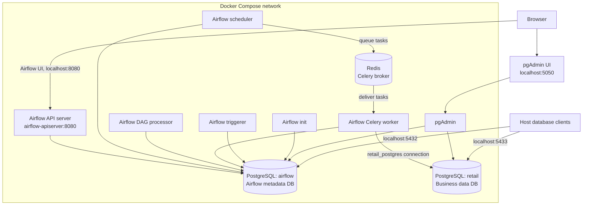
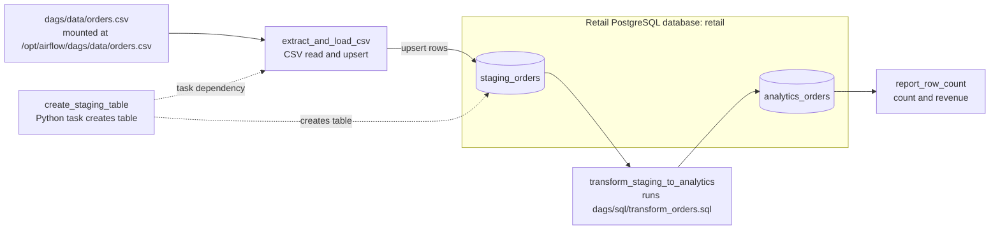

# Airflow project architecture

## Docker Compose services

Airflow metadata and retail business data are stored in separate PostgreSQL
services and Docker volumes. Redis is the Celery message broker; it is not a
database for either Airflow metadata or retail orders. The Airflow services
share the project DAG, logs, config, and plugins mounts.

## Retail orders DAG

The task order is create staging table, load/upsert CSV rows, rebuild analytics,
then report row count and revenue. Airflow tasks connect to the business
database using the Airflow connection ID `retail_postgres` and Docker hostname
`retail-postgres`.

`dags/sql/create_analytics_table.sql` is present in the project, but the DAG
currently creates `analytics_orders` through `transform_orders.sql` instead.
